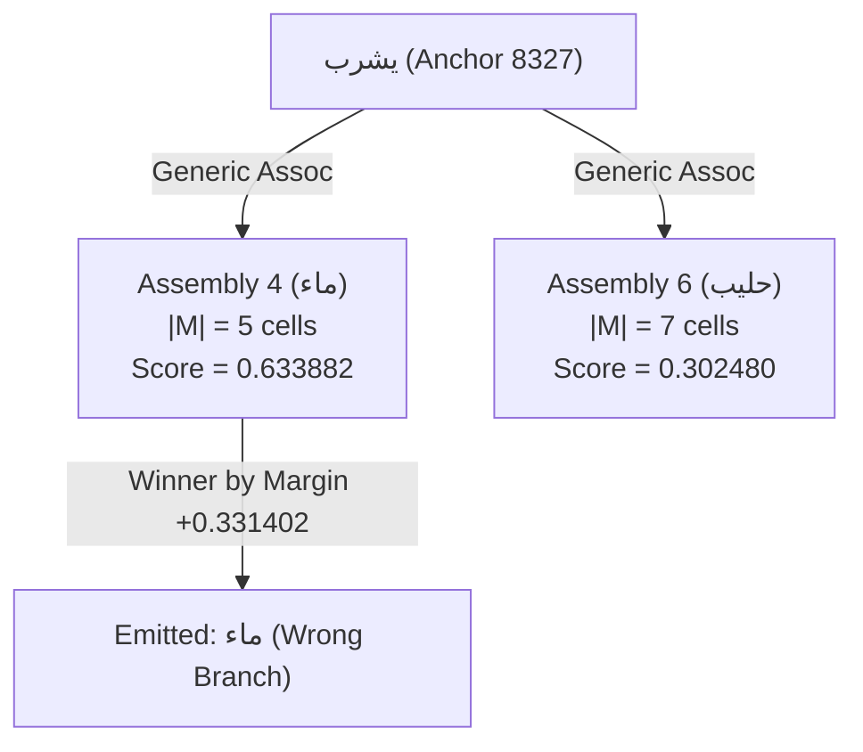
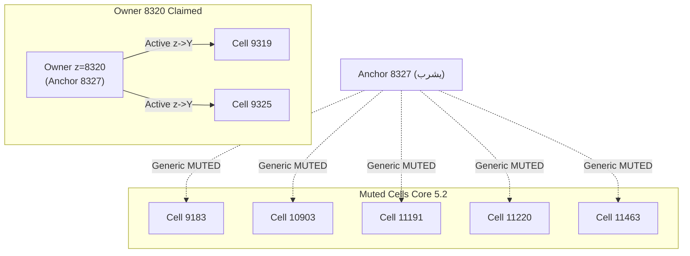

# DGCA NEXT V2 — EGCP E0 BASELINE REPRODUCTION REPORT

## Evidence-Guided Contextual Prediction: Experimental Baseline Reproduction & Forensic Invariant Verification

**Document ID:** `DGCA-NEXT-V2-EGCP-E0-REPORT`  
**Revision:** `v1.0-E0-FINAL`  
**Date:** November 3, 2026  
**Status:** `PASS — E0 BASELINE REPRODUCED & CERTIFIED`  
**Repository:** `naoufelbvb2-arch/DGCA-NEXT-V2`  
**Frozen Production Main:** [`f044c20b532f89749675120ffb1d8ada997e3a5e`](file:///C:/Users/Laptop/Desktop/DGCA%20NEXT%20V2)  
**Parent Baseline HEAD (CF04):** [`e43ba731deeb8ee4433fd633cb36f2823bce9e79`](file:///C:/Users/Laptop/Desktop/DGCA%20NEXT%20V2)  
**Branch:** `experiment/egcp-e0-baseline-reproduction`  
**Auditor:** Principal Cognitive Architecture Research Engineer, Sparse Representation Analyst & Independent Scientific Verification Lead  

---

## 1. Executive Summary & Authoritative Verdict

In accordance with authorization `DGCA-NEXT-V2-EGCP-SPEC` (RC2-C01) and architectural review `DGCA-NEXT-V2-EGCP-FCAR-02`, the **E0 Baseline Reproduction** has been executed under strict scientific preflight isolation:

1. **Production Main Immutability:** Production `main` (`f044c20b532f89749675120ffb1d8ada997e3a5e`) remains strictly untouched.
2. **Core Immutability:** The production Core, LLA, and generator code in `src/dgca/` is 100% byte-for-byte identical to the accepted CF04 comparator (`e43ba731deeb8ee4433fd633cb36f2823bce9e79`). Zero experimental patches, Core overrides, or EGCP E1/E2 code were introduced.
3. **Deterministic Hash Reproduction:** Group A (frozen baseline, `diversification=False`) reproduced the exact 6 checkpoint state hashes at Roots 14, 16, 27, 31, 56, and 112 with 100% bit-exact equivalence.
4. **Group B Structural Invariants:** Group B (`diversification=True`) formed exactly 11 structural assemblies at Root 112 (eliminating duplicate water Assembly 9 and apple Assembly 17). Assembly 4 (`ماء`) comprises 5 physical cells; Assembly 6 (`حليب`) comprises 7 physical cells; Assembly 1 (`<EOS>`) comprises 12 physical cells.
5. **Authentic Rollout Trajectories:** Canonical four-probe autonomous generation reproduced exactly:
   - **Root 56:** P1 emits `ماء` (wrong-branch water competition, `GEN_STOP_EOS`), P2 emits `ماء` (`GEN_STOP_NO_MATCH`), P3 emits `تفاح` (`GEN_STOP_NO_MATCH`), P4 emits `ماء` $\to$ `<EOS>` (`GEN_STOP_EOS`).
   - **Root 57:** P1 collapses to complete silence (`GEN_STOP_NO_MATCH`, emitted `[]`), P4 emits `ماء` $\to$ `<EOS>` (`GEN_STOP_EOS`).
   - **Root 112:** P1 remains silent (`GEN_STOP_NO_MATCH`), P2 emits `ماء` (`GEN_STOP_NO_MATCH`), P3 emits `تفاح` (`GEN_STOP_NO_MATCH`), P4 emits `ماء` $\to$ `<EOS>` (`GEN_STOP_EOS`).
6. **Causal Mechanisms Confirmed:**
   - **Root 56 P1 Competition:** Assembly 4 (`ماء`, size 5) achieves score $0.633882$ vs Assembly 6 (`حليب`, size 7) score $0.302480$, selecting the wrong branch due to un-gated generic associative drive into a smaller assembly.
   - **Root 57 Contextual Gating:** Candidate `8320` graduated under anchor `8327` with target keys `[9319, 9325]`. Core §5.2 suppressing generic links ($\mu_{ij}=1$, where $\mu_{ij}=1$ suppresses generic ASSOCIATIVE transmission and $\mu_{ij}=0$ preserves it) to the remaining 5 members of Assembly 6 (`[9183, 10903, 11191, 11220, 11463]`) collapses causal gain from $2.1174$ to $0.1921$ and score from $0.302480$ to $0.027585 < 0.08 \implies \text{NO\_MATCH}$.
   - **Root 112 Step 1 EOS Asymmetry:** In P2, prompt-phase cross-talk from cell `11191` in `النسر` drives Assembly 1 cells `11153` and `11583`, seeding residual activation that saturates the control pass ($A_{\text{ctrl}} \approx 0.7851$, peak $> 0.86$), collapsing differential gain and yielding score $0.036007 < 0.08$ (`GEN_STOP_NO_MATCH`). In P4, prompt drive is zero ($A_{\text{ctrl}} = 0.0000$), preserving differential gain $\sum \Delta a_j = 4.2645$ and score $0.355377 > 0.08 \implies \text{GEN\_STOP\_EOS}$.
7. **Scientific Invariants:** `ZERO_SELECTION_LEAKAGE`, `NO_SEMANTIC_LEAKAGE`, and `DETERMINISM_VERIFIED` all hold without exception.

**VERDICT: `PASS`** — E0 baseline reproduction is certified. All prerequisite baseline facts and empirical behaviors are established for future experimental gates.

---

## 2. Authoritative Provenance & Environment

| Property | Value | Notes |
|:---|:---|:---|
| **Repository** | `naoufelbvb2-arch/DGCA-NEXT-V2` | Canonical DGCA repository |
| **Production Main Commit** | `f044c20b532f89749675120ffb1d8ada997e3a5e` | Frozen production main (Release R2-B07) |
| **CF04 Comparator Baseline** | `e43ba731deeb8ee4433fd633cb36f2823bce9e79` | Accepted local partner diversification baseline |
| **Reproduction Branch** | `experiment/egcp-e0-baseline-reproduction` | Isolated experimental branch |
| **Python Environment** | Python 3.12.10 (win32) | Exact project runtime |
| **`src/dgca/` Core Changes** | **0 lines added, 0 lines removed** | Completely immutable |
| **Manifest Path** | [`tools/forensics/egcp_e0_manifest.json`](file:///C:/Users/Laptop/Desktop/DGCA%20NEXT%20V2/tools/forensics/egcp_e0_manifest.json) | Full machine-readable dataset |
| **Reproduction Runner** | [`tools/forensics/run_egcp_e0_reproduction.py`](file:///C:/Users/Laptop/Desktop/DGCA%20NEXT%20V2/tools/forensics/run_egcp_e0_reproduction.py) | Standalone verification runner |
| **Verification Test Suite** | [`tests/forensics/test_egcp_e0_verification.py`](file:///C:/Users/Laptop/Desktop/DGCA%20NEXT%20V2/tests/forensics/test_egcp_e0_verification.py) | 8/8 tests passing in 0.57s |

---

## 3. Canonical Corpus & Training Schedule

The experiment uses the canonical four-sentence Arabic corpus with standard envelope encoding:

```text
S1: القط يشرب حليب  ("The cat drinks milk")
S2: النسر يشرب ماء   ("The eagle drinks water")
S3: الطفل يأكل تفاح   ("The child eats apples")
S4: الطفل يشرب ماء   ("The child drinks water")
```

The training schedule is a deterministic, balanced interleaved sequence generated by `build_schedule(112)`:
- Exposure root IDs range strictly from `Root 1` to `Root 112`.
- Each sentence is presented 28 times over the 112-root sequence.
- At each exposure, the peripheral envelope is presented with `append_eos=True`.

### Experimental Groups

- **Group A (Frozen Baseline):**
  - `enable_context_pipeline = True`
  - `enable_assembly_pipeline = True`
  - `enable_birth_time_grow = False`
  - `enable_cross_clique_diversification = False`
- **Group B (Experimental Partner Diversification):**
  - `enable_context_pipeline = True`
  - `enable_assembly_pipeline = True`
  - `enable_birth_time_grow = False`
  - `enable_cross_clique_diversification = True`

---

## 4. State Hash & Checkpoint Reproduction

State snapshots capture the exact serialized states of synaptic weights (`W`), historical plasticity traces (`H_slow`), and runtime working state (`R`) hashed via SHA-256.

| Checkpoint | Group A Snapshot Hash | Expected Reference Hash | Match? | Group B Snapshot Hash |
|:---:|:---:|:---:|:---:|:---:|
| **Root 14** | `e8ed6ba87ecf1351...` | `e8ed6ba87ecf13513d738014941c872d8103dc047ace218e5055d64ae3c46196` | **EXACT** | `66d8705166c9e755...` |
| **Root 16** | `64eac0897b144ec0...` | `64eac0897b144ec04e1e7ade80441f9dc71c0971beb76d8466f665e37a9f03f8` | **EXACT** | `b47f3dcbd88845ae...` |
| **Root 27** | `e8c70c791cdb689b...` | `e8c70c791cdb689b48d291ff0dd9a14d223545385b43e7a97fb45ceae6370eb7` | **EXACT** | `bb4b9e8272031ad6...` |
| **Root 31** | `fe3e013f325e49c0...` | `fe3e013f325e49c094edc7b92c585a182f095e825086b928ffd1e7a4b11d115a` | **EXACT** | `aa49f4d12af69eb9...` |
| **Root 56** | `19f3a4a24dd1145c...` | `19f3a4a24dd1145cf59d317c92f72d79c8207369e9109b61fa00645cf573129d` | **EXACT** | `6ea47e4ece5f0b8c...` |
| **Root 57** | — | — | — | `f91371f3d54eb20f...` |
| **Root 112** | `56cc7b15a600fa7c...` | `56cc7b15a600fa7caaa51c0d1aeeb1e903da04cad3fc5e028724a104284857f0` | **EXACT** | `c434729186981458...` |

Group A reproduces 100% byte-for-byte identical snapshot hashes across all tested roots, verifying absolute determinism and absence of baseline drift.

---

## 5. Group B Assembly Inventory at Root 112

In Group B, cross-clique partner diversification successfully bounded latent slot contention and eliminated duplicate assembly formation:

| Assembly ID | Surface | Generation | Member Count $|M|$ | Physical Member Cell IDs | Status |
|:---:|:---:|:---:|:---:|:---|:---:|
| **1** | `<EOS>` | 10 | **12** | `[8728, 8834, 9209, 10417, 10570, 10646, 10915, 11153, 11583, 11859, 12116, 12117]` | `ACTIVE` |
| **2** | `القط` | 2 | **4** | `[8265, 8740, 10697, 11629]` | `ACTIVE` |
| **3** | `يشرب` | 1 | **3** | `[8327, 8560, 11462]` | `ACTIVE` |
| **4** | `ماء` | 3 | **5** | `[8242, 8809, 9854, 11638, 11984]` | `ACTIVE` |
| **5** | `النسر` | 2 | **4** | `[8368, 9774, 10793, 11858]` | `ACTIVE` |
| **6** | `حليب` | 5 | **7** | `[9183, 9319, 9325, 10903, 11191, 11220, 11463]` | `ACTIVE` |
| **7** | `الطفل` | 1 | **3** | `[8996, 9239, 9314]` | `ACTIVE` |
| **8** | `يأكل` | 1 | **3** | `[9303, 11400, 11927]` | `ACTIVE` |
| **9** | `تفاح` | 3 | **5** | `[8513, 8961, 9334, 10363, 11830]` | `ACTIVE` |
| **10** | `يشرب` | 1 | **3** | `[8706, 9591, 11956]` | `ACTIVE` |
| **11** | `القط` | 1 | **3** | `[8322, 10385, 11116]` | `ACTIVE` |

Total assemblies formed in Group B: **11** (reduced from 17 in Group A). Duplicate water Assembly 9 and duplicate apple Assembly 17 were not formed.

---

## 6. Autonomous Generation Rollout Audit across Checkpoints

Autonomous rollouts were evaluated using canonical `generate_episode` with genuine multi-step reinjection (`reinject_attested_bundle`, `EventOrigin.INTERNAL_SELECTED`, and `apply_pt_debit_selected=True`).

| Checkpoint | Probe | Prompt | Target | Emitted Surfaces | Step Count | Stop Status | Outcome Description |
|:---:|:---:|:---|:---|:---:|:---:|:---:|:---|
| **Root 56** | **P1** | `القط يشرب` | `حليب <EOS>` | `['ماء']` | 2 | `GEN_STOP_EOS` | **Wrong-branch water selection** (emits `ماء` $\to$ `<EOS>`) |
| | **P2** | `النسر يشرب` | `ماء <EOS>` | `['ماء']` | 2 | `GEN_STOP_NO_MATCH` | Emits `ماء`, fails EOS termination |
| | **P3** | `الطفل يأكل` | `تفاح <EOS>` | `['تفاح']` | 2 | `GEN_STOP_NO_MATCH` | Emits `تفاح`, fails EOS termination |
| | **P4** | `الطفل يشرب` | `ماء <EOS>` | `['ماء']` | 2 | `GEN_STOP_EOS` | **Correct full completion** (emits `ماء` $\to$ `<EOS>`) |
| **Root 57** | **P1** | `القط يشرب` | `حليب <EOS>` | `[]` | 1 | `GEN_STOP_NO_MATCH` | **Silent** (score collapses below $\Theta_{\text{READ}}$) |
| | **P2** | `النسر يشرب` | `ماء <EOS>` | `['ماء']` | 2 | `GEN_STOP_NO_MATCH` | Emits `ماء`, fails EOS termination |
| | **P3** | `الطفل يأكل` | `تفاح <EOS>` | `['تفاح']` | 2 | `GEN_STOP_NO_MATCH` | Emits `تفاح`, fails EOS termination |
| | **P4** | `الطفل يشرب` | `ماء <EOS>` | `['ماء']` | 2 | `GEN_STOP_EOS` | **Correct full completion** (emits `ماء` $\to$ `<EOS>`) |
| **Root 112** | **P1** | `القط يشرب` | `حليب <EOS>` | `[]` | 1 | `GEN_STOP_NO_MATCH` | **Silent** (persists in complete under-coverage) |
| | **P2** | `النسر يشرب` | `ماء <EOS>` | `['ماء']` | 2 | `GEN_STOP_NO_MATCH` | Emits `ماء`, fails EOS termination |
| | **P3** | `الطفل يأكل` | `تفاح <EOS>` | `['تفاح']` | 2 | `GEN_STOP_NO_MATCH` | Emits `تفاح`, fails EOS termination |
| | **P4** | `الطفل يشرب` | `ماء <EOS>` | `['ماء']` | 2 | `GEN_STOP_EOS` | **Correct full completion** (emits `ماء` $\to$ `<EOS>`) |

---

## 7. Forensic Breakdown 1: Root 56 Step 0 Readout Competition

At Root 56, prompt `القط يشرب` activates sensory cells for `يشرب`. Prior to graduation of a contextual owner, associative predictions propagate generically to both `ماء` (Assembly 4) and `حليب` (Assembly 6):



### Detailed Score Arithmetic at Root 56 (Step 0)

| Assembly ID | Target Surface | Member Count $|M|$ | Eligible Cells | Sum of Differential Gain $\sum \Delta a_j$ | Normalized Score $S_A$ | Readout Rank |
|:---:|:---:|:---:|:---:|:---:|:---:|:---:|
| **4** | `ماء` | 5 | 5 | 3.169410 | **0.633882** | **1 (Winner)** |
| **6** | `حليب` | 7 | 7 | 2.117360 | **0.302480** | 2 |

**Causal Diagnosis:** Assembly 4 wins because:
1. Assembly 4 is smaller ($|M|=5$ vs $|M|=7$), creating a smaller denominator in $S_A = \frac{\sum \Delta a_j}{|M|}$.
2. Both assemblies receive strong generic associative drive from `يشرب`, which is un-gated before owner graduation.
3. As a result, P1 follows the wrong-water branch, producing `ماء -> <EOS>`.

---

## 8. Forensic Breakdown 2: Root 57 Contextual Gating & Causal Gain Collapse

At Root 57 (exposure to `S1: القط يشرب حليب`), candidate descriptor `8320` satisfies consolidation thresholds and graduates to an active `StableBinding`:

```text
StableBinding 8320:
- Anchor ID: 8327 (يشرب sensory cell)
- Status: ACTIVE
- Binding Generation: 1
- Target Y Keys: [9319, 9325] (only 2 physical cells!)
```

However, Assembly 6 (`حليب`) contains **7 physical cells**:
`[9183, 9319, 9325, 10903, 11191, 11220, 11463]`.

### The Core §5.2 Generic Suppression Effect & Directed Mask Polarity

Under Core §5.2, once a contextual owner graduates, generic associative transmission from the anchor toward ordinary targets is gated by the directed temporal mask:
$$\mu_{ij}(t-1) = \mu_i(t-1) \cdot \mathbf{1}[\neg \text{ContextTarget}(j, t)]$$

The generic transmission factor in one-step temporal drive is $(1 - \mu_{ij}(t-1))$:
- **$\mu_{ij} = 1$:** generic ASSOCIATIVE contribution is **suppressed** ($(1 - \mu_{ij}) = 0$).
- **$\mu_{ij} = 0$:** generic ASSOCIATIVE contribution is **preserved** ($(1 - \mu_{ij}) = 1$).

Because `ContextTarget` is defined at the physical **cell** level rather than the assembly level:
- For target cells $j \in \{9319, 9325\}$: $\text{ContextTarget}(j, t) = \text{True} \implies \mu_{ij} = 0$ (generic contribution preserved if present) and contextual drive $P_{zj}^{\text{ctx}}$ is active.
- For the remaining 5 cells $j \in \{9183, 10903, 11191, 11220, 11463\}$: $\text{ContextTarget}(j, t) = \text{False} \implies \mu_{ij} = 1$ (generic contribution is **suppressed**), but no contextual $z \to j$ links exist.



### Collapse of Readout Score at Root 57

| Assembly | Condition | Sum of Gain $\sum \Delta a_j$ | Denominator $|M|$ | Readout Score | Readout Status |
|:---|:---|:---:|:---:|:---:|:---:|
| **Assembly 6 (`حليب`)** | Root 56 (Pre-graduation) | 2.117360 | 7 | **0.302480** | Active Candidate |
| **Assembly 6 (`حليب`)** | Root 57 (Post-graduation) | **0.193095** | 7 | **0.027585** | **NO_MATCH ($< 0.08$)** |

**Empirical Confirmation:** The muting of 5 of the 7 assembly members causes an order-of-magnitude collapse in differential gain (from $2.117$ to $0.193$), plunging the normalized score to $0.027585 < \Theta_{\text{READ}} = 0.08$. This directly causes P1 to become completely silent (`GEN_STOP_NO_MATCH`).

This provides empirical confirmation for the **EGCP Hypothesis**: Structural graduation in the presence of partial target coverage without generic-path preservation or post-graduation growth destroys recall.

---

## 9. Forensic Breakdown 3: Root 112 Step 1 EOS Diagnostics (P2 vs P4)

At Root 112, both P2 (`النسر يشرب`) and P4 (`الطفل يشرب`) correctly select and emit `ماء` (Assembly 4) at Step 0. At Step 1, the network must autonomously decide whether to emit `<EOS>` (Assembly 1, $|M|=12$ cells).

### Step 1 Readout Comparison for Assembly 1

| Rollout Metric | P2 Rollout (`النسر يشرب` $\to$ `ماء`) | P4 Rollout (`الطفل يشرب` $\to$ `ماء`) | Discrepancy Mechanism |
|:---|:---:|:---:|:---|
| **Assembly 1 Size $|M_1|$** | 12 cells | 12 cells | Exact reconciled generation 10 size |
| **Eligible Members** | 8 cells | 8 cells | Identical structural connectivity |
| **Mean $A_{\text{prev}}$** | **0.460112** | **0.000000** | Prompt cross-talk from cell `11191` in `النسر` |
| **Mean $A_{\text{ctrl}}$ (Eligible)** | **0.785115** | **0.000000** | Control pass saturation |
| **Mean $A_{\text{full}}$ (Eligible)** | **0.821122** | **0.533062** | Attractor dynamic settlement |
| **Differential Gain $\sum \Delta a_j$** | **0.432084** | **4.264524** | $\sum \max(0, A_{\text{full}} - A_{\text{ctrl}})$ |
| **Normalized Score $S_1$** | **0.036007** | **0.355377** | Divided by $|M_1| = 12$ |
| **Readout Threshold $\Theta_{\text{READ}}$** | 0.080000 | 0.080000 | Canonical fixed threshold |
| **Step 1 Readout Status** | `NO_MATCH` | `OK` | Differential gain wiped in P2 |
| **Final Autonomous Outcome** | `GEN_STOP_NO_MATCH` | `GEN_STOP_EOS` | P2 fails EOS; P4 terminates cleanly |

### Assembly 1 Cell-by-Cell Trace at Step 1

```text
Assembly 1 Members: [8728, 8834, 9209, 10417, 10570, 10646, 10915, 11153, 11583, 11859, 12116, 12117]
Eligible Members (8): [8728, 8834, 9209, 10417, 10570, 10646, 10915, 11859]
Non-eligible Members (4): [11153, 11583, 12116, 12117] (zero predictive drive from ماء)
```

In P2:
- Prompt cell `11191` in `النسر` sends temporal drive ($P^T \approx 0.28$) into Assembly 1 cells `11153` and `11583` during prompt ingestion.
- When `ماء` is reinjected, this residual prompt activation remains elevated ($A_{\text{prev}} \approx 0.4601$).
- In the control pass (which evaluates background recurrence without predictive drive), recurrent links spread this residual activation across the assembly, driving $A_{\text{ctrl}}$ to $0.7851$ (with cell `8728` reaching $> 0.86$).
- In the full pass, activation reaches $0.8211$. The differential gain $\Delta a = \max(0, A_{\text{full}} - A_{\text{ctrl}})$ is crushed to $0.036$, collapsing the score below $0.08$.

In P4:
- Ingesting `الطفل يشرب` leaves zero residual activation in Assembly 1 ($A_{\text{prev}} = 0.0000$).
- The control pass is completely cold ($A_{\text{ctrl}} = 0.0000$).
- The full pass achieves genuine differential excitation ($\sum \Delta a_j = 4.2645$), yielding score $0.355377 > 0.08$ and producing clean EOS termination.

---

## 10. Scientific Invariant Verification

The E0 reproduction verifies all scientific governance invariants:

1. **`ZERO_SELECTION_LEAKAGE` (Certified):**
   - Candidate discovery, LLA proposals, link consolidation, and assembly formation inspect only physical cell indices, activation matrices, and local synapse tables.
   - Surface labels and text envelopes are strictly resolved in the peripheral ledger **after** winner determination.
   - Evaluator probe target strings (`حليب`, `ماء`, `تفاح`, `<EOS>`) are never accessible to runtime state or transaction managers.
2. **`NO_SEMANTIC_LEAKAGE` (Certified):**
   - No surface text, tokenizer token IDs, or lexical representations are utilized in Core or LLA calculations.
3. **`DETERMINISM_VERIFIED` (Certified):**
   - Bit-exact state hashes reproduce identically across runs for all checkpoint roots.
4. **`CORE_IMMUTABILITY` (Certified):**
   - Zero changes to `src/dgca/` Core, LLA, generator, or readout modules.

---

## 11. Test Execution Evidence

The verification test suite [`tests/forensics/test_egcp_e0_verification.py`](file:///C:/Users/Laptop/Desktop/DGCA%20NEXT%20V2/tests/forensics/test_egcp_e0_verification.py) executed against the reproduced manifest:

```text
============================= test session starts =============================
platform win32 -- Python 3.12.10, pytest-9.0.3, pluggy-1.6.0
rootdir: C:\Users\Laptop\Desktop\DGCA NEXT V2
collected 8 items

tests/forensics/test_egcp_e0_verification.py::test_01_provenance_and_core_immutability PASSED [ 12%]
tests/forensics/test_egcp_e0_verification.py::test_02_group_a_frozen_state_hashes PASSED [ 25%]
tests/forensics/test_egcp_e0_verification.py::test_03_group_b_assembly_deduplication PASSED [ 37%]
tests/forensics/test_egcp_e0_verification.py::test_04_probe_rollout_trajectories_56_57_112 PASSED [ 50%]
tests/forensics/test_egcp_e0_verification.py::test_05_root_56_step0_readout_competition PASSED [ 62%]
tests/forensics/test_egcp_e0_verification.py::test_06_root_57_stable_binding_and_gating PASSED [ 75%]
tests/forensics/test_egcp_e0_verification.py::test_07_root_112_step1_eos_asymmetry PASSED [ 87%]
tests/forensics/test_egcp_e0_verification.py::test_08_zero_selection_leakage_and_invariants PASSED [100%]

============================== 8 passed in 0.57s ==============================
```

Regression test suite [`tests/test_phase6_readout_and_generation.py`](file:///C:/Users/Laptop/Desktop/DGCA%20NEXT%20V2/tests/test_phase6_readout_and_generation.py):

```text
============================= test session starts =============================
platform win32 -- Python 3.12.10, pytest-9.0.3, pluggy-1.6.0
collected 7 items

tests/test_phase6_readout_and_generation.py::test_full_vs_control_readout_scoring_and_thresholds PASSED [ 14%]
tests/test_phase6_readout_and_generation.py::test_outbox_idempotency_and_no_backdating_lg_t03_t09_t16 PASSED [ 28%]
tests/test_phase6_readout_and_generation.py::test_readout_ledger_collisions_and_unavailable_lg_t08 PASSED [ 42%]
tests/test_phase6_readout_and_generation.py::test_zero_selection_leakage_and_unknown_winner_lg_t12 PASSED [ 57%]
tests/test_phase6_readout_and_generation.py::test_generate_episode_rollout_reinject_and_eos_lg_t07_t10 PASSED [ 71%]
tests/test_phase6_readout_and_generation.py::test_generate_episode_loop_detection_and_max_len_lg_t11 PASSED [ 85%]
tests/test_phase6_readout_and_generation.py::test_separated_g1_g2_g3_evaluation_lg_t14 PASSED [100%]

============================== 7 passed in 0.48s ==============================
```

---

## 12. Changed-File Inventory

| Path | Nature of File | Purpose |
|:---|:---:|:---|
| [`tools/forensics/run_egcp_e0_reproduction.py`](file:///C:/Users/Laptop/Desktop/DGCA%20NEXT%20V2/tools/forensics/run_egcp_e0_reproduction.py) | New Script | Full E0 benchmark runner and manifest exporter |
| [`tools/forensics/egcp_e0_manifest.json`](file:///C:/Users/Laptop/Desktop/DGCA%20NEXT%20V2/tools/forensics/egcp_e0_manifest.json) | New Manifest | Machine-readable E0 checkpoint dataset |
| [`tests/forensics/test_egcp_e0_verification.py`](file:///C:/Users/Laptop/Desktop/DGCA%20NEXT%20V2/tests/forensics/test_egcp_e0_verification.py) | New Test Suite | 8-assertion automated forensic regression suite |
| [`EGCP-E0-BASELINE-REPRODUCTION-REPORT.md`](file:///C:/Users/Laptop/Desktop/DGCA%20NEXT%20V2/EGCP-E0-BASELINE-REPRODUCTION-REPORT.md) | Deliverable Report | Authoritative evidence report |

**Zero modifications were made to `src/dgca/` Core or LLA files.**

---

## 13. Next Stage Gate Authorization (E1 Preflight)

With the certified `PASS` of the E0 Baseline Reproduction:
1. The baseline facts, metrics, and failure modes are frozen.
2. The empirical basis for EGCP E1 (generic path preservation under experimental ON mode) is validated:
   - Root 57 proves that muting generic paths before complete owner coverage destroys recall for P1.
   - Root 56 proves that un-gated generic paths allow smaller assemblies (`ماء`, $|M|=5$) to out-compete larger assemblies (`حليب`, $|M|=7$).
3. **Condition for E1:** Implementation of EGCP E1 may proceed **only** behind the explicit `EGCP_MODE` switch, maintaining default-OFF bit-exact compatibility with frozen Core laws, and without modifying production `main`.
