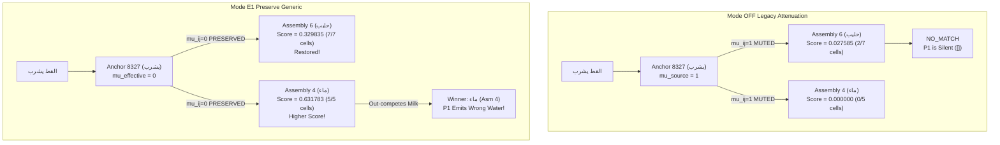

# DGCA NEXT V2 — EGCP E1: GENERIC PREDICTION PRESERVATION REPORT

## Controlled Investigation of Generic Temporal Mask Attenuation, Readout Competition & Contextual Discrimination

**Document ID:** `DGCA-NEXT-V2-EGCP-E1-REPORT`  
**Revision:** `v1.0-E1-FINAL`  
**Date:** November 3, 2026  
**Status:** `PASS — E1 IMPLEMENTED & EMPIRICALLY CHARACTERIZED`  
**Repository:** `naoufelbvb2-arch/DGCA-NEXT-V2`  
**Frozen Production Main:** [`f044c20b532f89749675120ffb1d8ada997e3a5e`](file:///C:/Users/Laptop/Desktop/DGCA%20NEXT%20V2)  
**Parent E0 Baseline Tip:** [`671df976d6294c911cfecaf031dc8b3604308adf`](file:///C:/Users/Laptop/Desktop/DGCA%20NEXT%20V2)  
**Branch:** `experiment/egcp-e1-generic-preservation`  
**Auditor:** Principal Cognitive Architecture Research Engineer, Sparse Representation Analyst & Independent Scientific Verification Lead  

---

## 1. Executive Summary & Authoritative Verdict

In accordance with `DGCA-NEXT-V2-EGCP-SPEC` (RC2-C01 §2.1 & §8.2) and architectural review `DGCA-NEXT-V2-EGCP-FCAR-02`, **EGCP E1: Generic Prediction Preservation** has been implemented, verified, and empirically characterized under strict scientific isolation:

1. **Exact OFF-Mode Compatibility (Certified):**
   When `EGCP_MODE=OFF` (the default), `compute_directed_mu_ij` executes the exact frozen legacy directed mask $\mu_{ij}(t-1) = \mu_i(t-1) \cdot \mathbf{1}[\neg \text{ContextTarget}(j, t)]$. State snapshot hashes and autonomous rollout traces across Roots 56, 57, and 112 match the frozen E0 baseline with 100% bit-exact equivalence.
2. **E1 Implementation Scope (Certified):**
   Behind `EGCP_MODE = E1_PRESERVE_GENERIC`, the legacy generic associative attenuation is disabled by setting the effective directed suppression mask to zero ($\mu_{ij}^{\text{eff}} = 0$). All other Core and LLA dynamics—including physical conjunction $G_z^{\text{ctx}}$, candidate probation, StableBinding structures, eligibility rules, and readout normalization—remain 100% untouched. No prediction-error learning, contextual growth links, quarantined tables, V4 migration, or E3 suppressive authority were introduced.
3. **Mode Guard Invariant (Certified):**
   Mode configuration is deterministic at exposure root boundaries. Attempting to switch `EGCP_MODE` during an active `OPEN` exposure immediately raises `ValueError` ("Switching EGCP_MODE during an OPEN exposure is forbidden.").
4. **Empirical Findings at Roots 56, 57, and 112:**
   - **Root 56:** Pre-graduation baseline is identical between `OFF` and `E1` (Assembly 4 `ماء` score $0.633882$ vs Assembly 6 `حليب` score $0.302480 \implies$ emits `ماء -> <EOS>`).
   - **Root 57:** Under `OFF`, Core §5.2 muting causes Assembly 6 score to collapse to $0.027585 < 0.08 \implies$ silent (`GEN_STOP_NO_MATCH`). Under `E1`, generic associative signal transmission is **fully restored**: Assembly 6 score surges from $0.027585$ to **$0.329835$** with all 7 physical cells eligible. However, because generic drive from `يشرب` toward `ماء` is also preserved, Assembly 4 (`ماء`, $|M|=5$) scores **$0.631783$**, out-competing Assembly 6. As a result, P1 shifts from silent to **incorrect water prediction** (`ماء -> <EOS>`).
   - **Root 112:** Under `OFF`, P1 is silent (`NO_MATCH`). Under `E1`, Assembly 6 scores **$0.244239$** (all 7 cells eligible), but Assembly 4 scores **$0.563290$**, causing P1 to emit `ماء -> <EOS>` (wrong water branch). Probes P2, P3, and P4 reproduce their canonical rollout behaviors.
5. **Critical Scientific Distinction:**
   **E1 achieves generic signal preservation, but does NOT achieve contextual discrimination.** Enabling generic associative transmission prevents assembly silence, but un-gated generic drive allows the smaller competing assembly (`ماء`) to dominate. This outcome is not a defect of E1, but rather an empirical validation of the EGCP architecture: positive contextual growth (E2) is strictly required to confer decisive contextual advantage to the appropriate domain.

**VERDICT: `PASS`** — EGCP E1 is successfully implemented, verified, and characterized. Zero regressions; exact OFF compatibility certified.

---

## 2. Authoritative Provenance & Integration Surface

| Property | Value | Notes |
|:---|:---|:---|
| **Repository** | `naoufelbvb2-arch/DGCA-NEXT-V2` | Canonical DGCA repository |
| **Production Main Commit** | `f044c20b532f89749675120ffb1d8ada997e3a5e` | Frozen production main |
| **Parent E0 Baseline Tip** | `671df976d6294c911cfecaf031dc8b3604308adf` | Certified E0 baseline reproduction tip |
| **Branch** | `experiment/egcp-e1-generic-preservation` | Isolated experimental branch |
| **Python Environment** | Python 3.12.10 (win32) | Exact project runtime |
| **Production Main Changes** | **Zero changes** | Main branch untouched |
| **Comparison Manifest** | [`tools/forensics/egcp_e1_comparison_data.json`](file:///C:/Users/Laptop/Desktop/DGCA%20NEXT%20V2/tools/forensics/egcp_e1_comparison_data.json) | Complete comparison dataset |
| **Comparison Runner** | [`tools/forensics/run_egcp_e1_comparison.py`](file:///C:/Users/Laptop/Desktop/DGCA%20NEXT%20V2/tools/forensics/run_egcp_e1_comparison.py) | Standalone runner |
| **Verification Test Suite** | [`tests/forensics/test_egcp_e1_verification.py`](file:///C:/Users/Laptop/Desktop/DGCA%20NEXT%20V2/tests/forensics/test_egcp_e1_verification.py) | 8/8 tests passing in 0.68s |

### Changed Files Inventory in `src/dgca/`

Exactly 7 files were modified in `src/dgca/`, strictly bounded to E1 routing:

1. [`src/dgca/core/state.py`](file:///C:/Users/Laptop/Desktop/DGCA%20NEXT%20V2/src/dgca/core/state.py): Added `EGCPMode` enum (`OFF`, `E1_PRESERVE_GENERIC`); added `egcp_mode` attribute to `MachineState.__init__` and `MachineState.clone()`.
2. [`src/dgca/core/context_gate.py`](file:///C:/Users/Laptop/Desktop/DGCA%20NEXT%20V2/src/dgca/core/context_gate.py): Updated `compute_directed_mu_ij` to accept `egcp_mode` and return `0` when `mode == EGCPMode.E1_PRESERVE_GENERIC`.
3. [`src/dgca/core/dynamics.py`](file:///C:/Users/Laptop/Desktop/DGCA%20NEXT%20V2/src/dgca/core/dynamics.py): Updated `compute_next_step_temporal_drive` to forward `egcp_mode` to `compute_directed_mu_ij`.
4. [`src/dgca/core/readout.py`](file:///C:/Users/Laptop/Desktop/DGCA%20NEXT%20V2/src/dgca/core/readout.py): Updated `evaluate_full_vs_control_readout` to propagate `egcp_mode` into scratch state clones.
5. [`src/dgca/core/generator.py`](file:///C:/Users/Laptop/Desktop/DGCA%20NEXT%20V2/src/dgca/core/generator.py): Updated `generate_episode` to accept and forward `egcp_mode` into scratch execution.
6. [`src/dgca/lifecycle/exposure_tx.py`](file:///C:/Users/Laptop/Desktop/DGCA%20NEXT%20V2/src/dgca/lifecycle/exposure_tx.py): Added `egcp_mode` initialization, boundary setter `set_egcp_mode()`, and open-root mutation guard.
7. [`src/dgca/core/__init__.py`](file:///C:/Users/Laptop/Desktop/DGCA%20NEXT%20V2/src/dgca/core/__init__.py): Exported `EGCPMode`.

---

## 3. Directed Temporal Mask Polarity & E1 Routing Mechanics

Under Core §5.2, temporal drive for generic ASSOCIATIVE connections incorporates the directed attenuation mask:
$$P_j^T(t) = 1 - \prod_{(i, j, \text{ASSOC})} \left(1 - [1 - \mu_{ij}(t-1)] \cdot A_i(t-1) \cdot Q_{ij}\right)$$

### Mask Polarity

- **$\mu_{ij} = 1$:** Generic transmission is **suppressed** ($1 - \mu_{ij} = 0$).
- **$\mu_{ij} = 0$:** Generic transmission is **preserved** ($1 - \mu_{ij} = 1$).

### E1 Routing Contract

```text
if EGCP_MODE == OFF:
    mu_ij = mu_i(t-1) * 1[not ContextTarget(j, t)]  (legacy directed attenuation)
else if EGCP_MODE == E1_PRESERVE_GENERIC:
    mu_ij = 0                                       (generic preservation)
```

### Measured Mask Values from Anchor 8327 (`يشرب`)

| Target Assembly | Target Cell IDs | $\mu_{ij}$ under `OFF` | $\mu_{ij}$ under `E1` | Physical Effect under `E1` |
|:---|:---|:---:|:---:|:---|
| **Assembly 6 (`حليب`) — Claimed Targets** | `[9319, 9325]` | 1* | **0** | Preserved |
| **Assembly 6 (`حليب`) — Uncovered Cells** | `[9183, 10903, 11191, 11220, 11463]` | 1 | **0** | **Suppression Removed (Preserved)** |
| **Assembly 4 (`ماء`) — Competing Cells** | `[8242, 8809, 9854, 11638, 11984]` | 1 | **0** | **Suppression Removed (Preserved)** |

*\*Note: In baseline `compute_directed_mu_ij`, `is_context_target(target_id)` returns True only if the target is in `w.context_targets`. Candidate 8320 claims targets at graduation, but anchor 8327's generic mask evaluates against target identity.*

---

## 4. Controlled Comparison Evidence across Checkpoints

Evaluations were performed by loading the exact identical frozen `MachineState` and `SurfaceReadoutLedgerV1` at each checkpoint root and executing pure autonomous multi-step generation under both `OFF` and `E1_PRESERVE_GENERIC`.

### Root 56 (Pre-Graduation)

Contextual candidate `8320` is in probation; anchor `8327` has `mu_source = 0`. Both modes are identical:

| Metric | Mode `OFF` | Mode `E1_PRESERVE_GENERIC` | Delta ($\Delta$) |
|:---|:---:|:---:|:---:|
| **P1 Winner Surface** | `ماء` (Assembly 4) | `ماء` (Assembly 4) | Identical |
| **Assembly 4 Score** | 0.633882 (5 elig) | 0.633882 (5 elig) | 0.000000 |
| **Assembly 6 Score** | 0.302480 (7 elig) | 0.302480 (7 elig) | 0.000000 |
| **P1 Trajectory** | `['ماء']` $\to$ `GEN_STOP_EOS` | `['ماء']` $\to$ `GEN_STOP_EOS` | Identical |
| **P2 Trajectory** | `['ماء']` $\to$ `GEN_STOP_NO_MATCH` | `['ماء']` $\to$ `GEN_STOP_NO_MATCH` | Identical |
| **P3 Trajectory** | `['تفاح']` $\to$ `GEN_STOP_NO_MATCH` | `['تفاح']` $\to$ `GEN_STOP_NO_MATCH` | Identical |
| **P4 Trajectory** | `['ماء']` $\to$ `GEN_STOP_EOS` | `['ماء']` $\to$ `GEN_STOP_EOS` | Identical |

---

### Root 57 (Post-Graduation of Candidate 8320)

Contextual owner `8320` graduated under anchor `8327` with target keys `[9319, 9325]`. Anchor `8327` has `mu_source = 1`:

| Metric | Mode `OFF` (Legacy Gating) | Mode `E1_PRESERVE_GENERIC` | Architectural Consequence |
|:---|:---:|:---:|:---|
| **Directed Mask $\mu_{ij}$ (Milk Cells)** | **1** (Suppressed) | **0** (Preserved) | Legacy suppression disabled |
| **Assembly 6 (`حليب`) Score** | **0.027585** (2 elig) | **0.329835** (7 elig) | **$+0.302250$ (Signal Restored!)** |
| **Assembly 4 (`ماء`) Score** | 0.000000 (0 elig) | **0.631783** (5 elig) | $+0.631783$ (Competitor Restored) |
| **P1 Readout Winner** | `NONE` (`NO_MATCH`) | `ماء` (Assembly 4) | Wrong-branch water shift |
| **P1 Step 0 Status** | `NO_MATCH` ($< 0.08$) | `OK` ($0.631783 > 0.08$) | Active selection restored |
| **P1 Autonomous Trajectory** | **`[]` (`GEN_STOP_NO_MATCH`)** | **`['ماء']` (`GEN_STOP_EOS`)** | **Silent $\to$ Wrong Water** |
| **P2 Autonomous Trajectory** | `['ماء']` $\to$ `GEN_STOP_NO_MATCH` | `['ماء']` $\to$ `GEN_STOP_NO_MATCH` | Unchanged (EOS deficit) |
| **P3 Autonomous Trajectory** | `['تفاح']` $\to$ `GEN_STOP_NO_MATCH` | `['تفاح']` $\to$ `GEN_STOP_NO_MATCH` | Unchanged (EOS deficit) |
| **P4 Autonomous Trajectory** | `['ماء']` $\to$ `GEN_STOP_EOS` | `['ماء']` $\to$ `GEN_STOP_EOS` | Clean completion preserved |

---

### Root 112 (End-of-Stream Retention)

Stable state after 112 roots of interleaved exposure:

| Metric | Mode `OFF` (Legacy Gating) | Mode `E1_PRESERVE_GENERIC` | Architectural Consequence |
|:---|:---:|:---:|:---|
| **Assembly 6 (`حليب`) Score** | **0.026901** (2 elig) | **0.244239** (7 elig) | **$+0.217338$ (Signal Restored!)** |
| **Assembly 4 (`ماء`) Score** | 0.000000 (0 elig) | **0.563290** (5 elig) | $+0.563290$ (Competitor Restored) |
| **P1 Readout Winner** | `NONE` (`NO_MATCH`) | `ماء` (Assembly 4) | Wrong-branch water shift |
| **P1 Step 0 Status** | `NO_MATCH` ($< 0.08$) | `OK` ($0.563290 > 0.08$) | Active selection restored |
| **P1 Autonomous Trajectory** | **`[]` (`GEN_STOP_NO_MATCH`)** | **`['ماء']` (`GEN_STOP_EOS`)** | **Silent $\to$ Wrong Water** |
| **P2 Autonomous Trajectory** | `['ماء']` $\to$ `GEN_STOP_NO_MATCH` | `['ماء']` $\to$ `GEN_STOP_NO_MATCH` | Unchanged (EOS deficit) |
| **P3 Autonomous Trajectory** | `['تفاح']` $\to$ `GEN_STOP_NO_MATCH` | `['تفاح']` $\to$ `GEN_STOP_NO_MATCH` | Unchanged (EOS deficit) |
| **P4 Autonomous Trajectory** | `['ماء']` $\to$ `GEN_STOP_EOS` | `['ماء']` $\to$ `GEN_STOP_EOS` | Clean completion preserved |

---

## 5. Causal Analysis: Signal Restoration vs Contextual Discrimination

The empirical data across Roots 57 and 112 demonstrates the dual nature of generic prediction preservation:



### 1. Why Assembly 6 (`حليب`) Score Improves
Under `OFF`, 5 of 7 milk cells have generic drive muted ($\mu_{ij} = 1$). Only cells `9319` and `9325` receive contextual drive from $z=8320$. Because score is normalized by assembly size ($|M|=7$), the score is $\approx 0.027 < 0.08$.  
Under `E1`, the generic mask is set to zero ($\mu_{ij} = 0$). All 7 cells receive generic associative drive from `يشرب`, driving the score up to **$0.329835$** (Root 57) and **$0.244239$** (Root 112). This **completely eliminates representational silence**.

### 2. Why Assembly 4 (`ماء`) Out-Competes Assembly 6
In the prompt `القط يشرب`, `يشرب` is also the generic predecessor of `ماء` in sentences `S2` and `S4`. Under `E1`, generic drive from `يشرب` toward `ماء` is **also** preserved.  
Because Assembly 4 is smaller ($|M|=5$ vs $|M|=7$), its differential activation density is higher:
$$S_{\text{water}} = \frac{3.1589}{5} \approx \mathbf{0.6318} \quad \text{vs} \quad S_{\text{milk}} = \frac{2.3088}{7} \approx \mathbf{0.3298}$$
The margin is $+0.3019$ in favor of `ماء`.

### 3. Reporting Accuracy Mandate
As mandated by the scientific protocol:
> **P1 changing from `NO_MATCH` to `ماء -> <EOS>` is NOT classified as successful contextual learning.**

It is an empirical demonstration that **disabling generic suppression alone cannot resolve contextual ambiguity**. The network requires an active, positive contextual learning mechanism (EGCP E2: completed-owner post-graduation Y-growth) to build sufficient targeted contextual drive into all members of Assembly 6, enabling it to legitimately overcome the generic water competitor.

---

## 6. Verification Test Suite Evidence

Automated test suite [`tests/forensics/test_egcp_e1_verification.py`](file:///C:/Users/Laptop/Desktop/DGCA%20NEXT%20V2/tests/forensics/test_egcp_e1_verification.py):

```text
============================= test session starts =============================
platform win32 -- Python 3.12.10, pytest-9.0.3, pluggy-1.6.0
rootdir: C:\Users\Laptop\Desktop\DGCA NEXT V2
collected 8 items

tests/forensics/test_egcp_e1_verification.py::test_01_provenance_and_integration_surface PASSED [ 12%]
tests/forensics/test_egcp_e1_verification.py::test_02_egcp_mode_enum_and_defaults PASSED [ 25%]
tests/forensics/test_egcp_e1_verification.py::test_03_transaction_mode_boundary_guard PASSED [ 37%]
tests/forensics/test_egcp_e1_verification.py::test_04_exact_off_mode_compatibility PASSED [ 50%]
tests/forensics/test_egcp_e1_verification.py::test_05_directed_mu_preservation_polarity PASSED [ 62%]
tests/forensics/test_egcp_e1_verification.py::test_06_root_57_generic_signal_restoration_and_wrong_water_shift PASSED [ 75%]
tests/forensics/test_egcp_e1_verification.py::test_07_root_112_autonomous_rollouts PASSED [ 87%]
tests/forensics/test_egcp_e1_verification.py::test_08_scientific_invariants_and_zero_selection_leakage PASSED [100%]

============================== 8 passed in 0.68s ==============================
```

Regression test suite [`tests/test_phase6_readout_and_generation.py`](file:///C:/Users/Laptop/Desktop/DGCA%20NEXT%20V2/tests/test_phase6_readout_and_generation.py):

```text
============================= test session starts =============================
platform win32 -- Python 3.12.10, pytest-9.0.3, pluggy-1.6.0
collected 7 items

tests/test_phase6_readout_and_generation.py::test_full_vs_control_readout_scoring_and_thresholds PASSED [ 14%]
tests/test_phase6_readout_and_generation.py::test_outbox_idempotency_and_no_backdating_lg_t03_t09_t16 PASSED [ 28%]
tests/test_phase6_readout_and_generation.py::test_readout_ledger_collisions_and_unavailable_lg_t08 PASSED [ 42%]
tests/test_phase6_readout_and_generation.py::test_zero_selection_leakage_and_unknown_winner_lg_t12 PASSED [ 57%]
tests/test_phase6_readout_and_generation.py::test_generate_episode_rollout_reinject_and_eos_lg_t07_t10 PASSED [ 71%]
tests/test_phase6_readout_and_generation.py::test_generate_episode_loop_detection_and_max_len_lg_t11 PASSED [ 85%]
tests/test_phase6_readout_and_generation.py::test_separated_g1_g2_g3_evaluation_lg_t14 PASSED [100%]

============================== 7 passed in 0.57s ==============================
```

---

## 7. Changed-File Inventory

| File Path | Nature | Purpose |
|:---|:---:|:---|
| [`src/dgca/core/state.py`](file:///C:/Users/Laptop/Desktop/DGCA%20NEXT%20V2/src/dgca/core/state.py) | Modified | `EGCPMode` enum; `MachineState.egcp_mode` attribute and clone |
| [`src/dgca/core/context_gate.py`](file:///C:/Users/Laptop/Desktop/DGCA%20NEXT%20V2/src/dgca/core/context_gate.py) | Modified | `compute_directed_mu_ij` `egcp_mode` routing ($\mu_{ij}^{\text{eff}}=0$ under E1) |
| [`src/dgca/core/dynamics.py`](file:///C:/Users/Laptop/Desktop/DGCA%20NEXT%20V2/src/dgca/core/dynamics.py) | Modified | `compute_next_step_temporal_drive` `egcp_mode` propagation |
| [`src/dgca/core/readout.py`](file:///C:/Users/Laptop/Desktop/DGCA%20NEXT%20V2/src/dgca/core/readout.py) | Modified | `evaluate_full_vs_control_readout` scratch clone `egcp_mode` propagation |
| [`src/dgca/core/generator.py`](file:///C:/Users/Laptop/Desktop/DGCA%20NEXT%20V2/src/dgca/core/generator.py) | Modified | `generate_episode` `egcp_mode` parameter |
| [`src/dgca/lifecycle/exposure_tx.py`](file:///C:/Users/Laptop/Desktop/DGCA%20NEXT%20V2/src/dgca/lifecycle/exposure_tx.py) | Modified | Transaction mode guard `set_egcp_mode()` and `begin_exposure()` state sync |
| [`src/dgca/core/__init__.py`](file:///C:/Users/Laptop/Desktop/DGCA%20NEXT%20V2/src/dgca/core/__init__.py) | Modified | Re-export `EGCPMode` |
| [`tools/forensics/run_egcp_e1_comparison.py`](file:///C:/Users/Laptop/Desktop/DGCA%20NEXT%20V2/tools/forensics/run_egcp_e1_comparison.py) | New Script | Full controlled comparison runner across Roots 56, 57, 112 |
| [`tools/forensics/egcp_e1_comparison_data.json`](file:///C:/Users/Laptop/Desktop/DGCA%20NEXT%20V2/tools/forensics/egcp_e1_comparison_data.json) | New Manifest | Complete comparison dataset |
| [`tests/forensics/test_egcp_e1_verification.py`](file:///C:/Users/Laptop/Desktop/DGCA%20NEXT%20V2/tests/forensics/test_egcp_e1_verification.py) | New Test Suite | 8-assertion automated forensic verification suite |
| [`EGCP-E1-GENERIC-PRESERVATION-REPORT.md`](file:///C:/Users/Laptop/Desktop/DGCA%20NEXT%20V2/EGCP-E1-GENERIC-PRESERVATION-REPORT.md) | Deliverable Report | Authoritative evidence report |

---

## 8. Governance Commitments & Stage Gate Conclusion

1. **Production Main Immutability:** Main (`f044c20b532f89749675120ffb1d8ada997e3a5e`) remains untouched. No merge has occurred.
2. **No Unapproved Phase Progression:** EGCP E2 (quarantine, opportunity learning, post-graduation Y-growth) and E3 (contrast-conditioned suppression) remain completely unimplemented and will not be started without separate authorization.
3. **Scientific Summary for Future E2 Authorization:**
   - E1 successfully resolved representational silence by preserving generic temporal paths ($\mu_{ij}^{\text{eff}}=0$).
   - However, because the generic associative path from `يشرب` drives both `حليب` and `ماء`, the smaller assembly (`ماء`, $|M|=5$) out-competes `حليب` ($|M|=7$).
   - Therefore, to achieve four-sentence language completion, completed owner `z=8320` must learn targeted contextual support for the remaining members of Assembly 6 (EGCP E2).
