# DGCA NEXT V2 — R2-C01-D01 Architectural Design Study
## Assembly Formation Regulation, Structural Reuse & Neural Competition

- **Study ID:** `R2-C01-D01`
- **Role:** Principal Cognitive Architecture Designer, Sparse Neural Learning Researcher, Scientific Governance Reviewer
- **Status:** **COMPLETE — ARCHITECTURAL DESIGN STUDY ONLY**
- **Repository:** `naoufelbvb2-arch/DGCA-NEXT-V2`
- **Design Branch:** `design/r2-c01-d01-assembly-formation-regulation`
- **Design Base HEAD:** `2cebcb28179c3f412f16c6c4547c98ee392bf8b4` (Accepted CF02 Experiment HEAD)
- **Production main (Frozen):** `f044c20b532f89749675120ffb1d8ada997e3a5e`
- **Authorized Verdict:**
  `R2-C01-D01 DESIGN COMPLETE — COUNTERFACTUAL PROPOSAL READY FOR REVIEW`

---

## 1. Authoritative Baselines & Preflight Corrections

### 1.1 Provenance
- Repository: `naoufelbvb2-arch/DGCA-NEXT-V2`
- Frozen production `main`: `f044c20b532f89749675120ffb1d8ada997e3a5e`
- Base experiment: `2cebcb28179c3f412f16c6c4547c98ee392bf8b4` (R2-C01-CF02)
- Production code diff: **0 lines modified** (`src/` strictly untouched).

### 1.2 Preflight Evidence Corrections
1. **Normative Readout Threshold (`THETA_READ`):**
   The CF02 narrative report mistakenly listed `THETA_READ = 0.30` in its parameter summary text. The actual frozen production constant in [`src/dgca/core/readout.py`](file:///c:/Users/Laptop/Desktop/DGCA%20NEXT%20V2/src/dgca/core/readout.py#L21) is:
   $$\Theta_{\text{READ}} = 0.08$$
   This narrative typo is hereby corrected; the actual runtime evaluation always deterministically executed with `THETA_READ = 0.08`.
2. **Normative Readout Margin (`M_READ`):**
   Preserved at $M_{\text{READ}} = 0.040000$ (Core §6.0, [`src/dgca/core/readout.py`](file:///c:/Users/Laptop/Desktop/DGCA%20NEXT%20V2/src/dgca/core/readout.py#L22)).
3. **Normative Merge Threshold (`THETA_MERGE`):**
   Preserved at $\Theta_{\text{MERGE}} = 0.70$ (Core §2.0, [`src/dgca/core/assembly.py`](file:///c:/Users/Laptop/Desktop/DGCA%20NEXT%20V2/src/dgca/core/assembly.py#L29)).
4. **Lifecycle Observation vs. Structural Commit Distinction:**
   - Observations collected during `process_event` represent transient activations ($A^+$, $A_{\text{full}}$, $A_{\text{ctrl}}$), link proposals staged in the open journal, and uncommitted sensory admissions.
   - Structural mutations (synapse consolidation, `MAINTAIN`, `GROW`, `FORM`, `MERGE`, `SPLIT`, and ledger attestations) are strictly committed during the atomic `END_EXPOSURE` close on the shadow state $W^*$.

---

## 2. Established Scientific Baseline

The following nine empirical observations are accepted as ground truth across R2-C01, F01, CF01, F02, and CF02:

1. **Broad Sensory Projection:** The lexical token `ماء` deterministically projects to **16 fixed sensory cells** in SIC-V1:
   $$\text{Footprint}(\text{ماء}) = \{8242, 8809, 8946, 9734, 9740, 9854, 10044, 10140, 10308, 10634, 10690, 11193, 11510, 11638, 11640, 11984\}$$
2. **Sparse Seed Triangle & Early Growth:** A primary assembly (Assembly 7 in Group A, Assembly 8 in Group B) forms from a 3-cell seed triangle (`[8242, 9854, 11638]`) on the 7th surface exposure (Root 14) and grows to 4 cells (+`[11984]`).
3. **Secondary Disjoint Assembly Formation:** A second assembly (Assembly 9 in both groups) forms from another sensory subset (`[8809, 9740, 10634]`) on the 8th surface exposure (Root 16) and grows to 7 cells (+4 cells).
4. **Coincident Ledger Resolution:** Both assemblies independently attest to the identical peripheral NFC UTF-8 string `"ماء"` in the downstream ledger.
5. **Context Invariance:** The phenomenon occurs under both two-context training (Group A: S2 `النسر` + S4 `الطفل`) and repeated single-context training (Group B: S2 `النسر` + S4 `النسر`).
6. **Cross-Lexical Invariance:** The exact same phenomenon occurs for `تفاح` in S3 `الطفل يأكل تفاح` (Assembly 14: 4 cells vs Assembly 17: 7 cells, $J = 0.0000$).
7. **Readout Competition:** Coexisting same-surface assemblies compete as independent rival candidates in the neural readout candidate pool.
8. **Multiplicity Does Not Strictly Entail Ambiguity:** While `ماء` halts in `GEN_STOP_AMBIGUOUS` ($\Delta < 0.04$), `تفاح` successfully breaks symmetry at Root 112 in both groups ($\Delta = 0.0487$ in Group A, $\Delta = 0.0592$ in Group B, both $> M_{\text{READ}} = 0.0400$), cleanly emitting `"تفاح"`.
9. **Benchmark Status:** Full autonomous four-sentence generation without halting or lexical error has not yet been demonstrated in the frozen architecture.

---

## 3. Formation and Growth Temporal Audit

A critical question arose from the R2-C01-CF02 findings: **Why did water assemblies undergo `GROW` at Roots 15 and 17, when the presented training sentences did not contain `ماء`?**

To answer this, a deterministic temporal audit tool [`tools/forensics/audit_r2_c01_d01_growth_timing.py`](file:///c:/Users/Laptop/Desktop/DGCA%20NEXT%20V2/tools/forensics/audit_r2_c01_d01_growth_timing.py) and test suite [`tests/forensics/test_r2_c01_d01_design.py`](file:///c:/Users/Laptop/Desktop/DGCA%20NEXT%20V2/tests/forensics/test_r2_c01_d01_design.py) were executed.

### 3.1 Trace Findings across Roots 14–17
* **Root 14 (S2: `النسر يشرب ماء`):**
  - Event 2 (`ماء`) co-activates all 16 sensory cells.
  - At Root 14 close, the assembly end pipeline executes in canonical order (Core §2.0):
    1. `MAINTAIN`
    2. `GROW` (Assembly 7 does not exist yet)
    3. `FORM` (Assembly 7 is born: founding triangle `[8242, 9854, 11638]`, Gen 1)
  - Crucially, during Root 14, reciprocal local synapses between cell `11984` and founding members `[8242, 9854, 11638]` **were already fully CONSOLIDATED** with confirmation count = 6 and efficacy $S = 0.88065$.
  - However, because Stage 2 (`GROW`) runs *before* Stage 3 (`FORM`), newly born Assembly 7 cannot recruit cell `11984` during Root 14 close.
* **Root 15 (S3: `الطفل يأكل تفاح`):**
  - Event processing runs for S3. Neither `ماء` nor cell `11984` are activated.
  - At Root 15 close, Stage 2 (`GROW`) evaluates all live assemblies in $W$.
  - Assembly 7 is inspected. Cell `11984` has pre-existing consolidated reciprocal support ($R_{11984, j}^B \ge 0.10$) with all members of Assembly 7.
  - Core §2.0 growth checks pass: $d = 3 \ge 2$, density $\ge 0.70$, spec $\ge 0.30$.
  - Assembly 7 recruits cell `11984`, advancing to Gen 2.
* **Root 16 (S4: `الطفل يشرب ماء` / `النسر يشرب ماء`):**
  - Event 2 (`ماء`) activates sensory cells.
  - At Root 16 close, Stage 3 (`FORM`) creates Assembly 9 on seed triangle `[8809, 9740, 10634]`.
  - At this exact moment, all 12 synapses connecting candidate cells `[9734, 10044, 10308, 11193]` to the founding triangle **were already fully CONSOLIDATED** with confirmation count = 7.
  - Stage 2 (`GROW`) had already completed prior to Stage 3 (`FORM`), so Assembly 9 remains at Gen 1.
* **Root 17 (S1: `القط يشرب حليب`):**
  - At Root 17 close, Stage 2 (`GROW`) evaluates live Assembly 9.
  - The 4 pre-consolidated candidate cells are lawfully committed, advancing Assembly 9 to Gen 5 (7 cells).

### 3.2 Audit Conclusion
The `GROW` events at Roots 15 and 17 are **lawful delayed structural commits** resulting from the canonical ordering of pipeline stages. They do **not** represent cross-context sensory leakage, illicit co-activation, or dynamic defect. They are the deterministic consequence of evaluating graph-structural support across $W$ accumulated during preceding exposures.

---

## 4. Architectural Alternatives Comparison

To address representational multiplicity and resulting readout ambiguity, three distinct architectural directions are evaluated:

```mermaid
flowchart TD
    subgraph Sensory_Input ["SIC-V1 Sensory Input (16 cells)"]
        S1["Active Sensory Footprint"]
    end

    subgraph Option_A ["Alternative A: Formation Regulation"]
        A1["Active Sensory Cells"] --> A2{"Is Receptive Field Covered\nby Existing Active Assembly?"}
        A2 -- Yes --> A3["Suppress Redundant FORM\n(Enforce Inhibitory Coverage)"]
        A2 -- No --> A4["Allow New Triangle Seed"]
    end

    subgraph Option_B ["Alternative B: Structural Reuse"]
        B1["Seed Triangle (3-4 cells)"] --> B2["Sensory Support Halo\n(Unrecruited Projection Cells)"]
        B2 --> B3["Bind Contextual Predictions\nto Shared Receptive Field"]
        B3 --> B4["Single Stable Assembly\nwithin K_MAX=16"]
    end

    subgraph Option_C ["Alternative C: Neural Competition"]
        C1["Multiple Disjoint Assemblies\n(Asm 7 & Asm 9)"] --> C2["Developmental Maturation\n& Differential Hebbian Gain"]
        C2 --> C3{"Margin Delta > M_READ?"}
        C3 -- Yes --> C4["Unambiguous Selection"]
        C3 -- No --> C5["Readout Ambiguity Check\nRefinement"]
    end
```

### 4.1 Detailed Evaluation Matrix

| Dimension | Alternative A: Formation Regulation | Alternative B: Structural Reuse | Alternative C: Neural Competition |
|:---|:---|:---|:---|
| **Core Proposed Mechanism** | Amend Core §2.0 item 3 (`FORM`): Before searching for candidate triangles in $U_t$, evaluate aggregate sensory footprint overlap with any currently activated live assembly. If an active assembly already covers $\ge \tau_{\text{sensory}}$ of the active sensory microcolumns, suppress secondary `FORM` from residual cells. | Amend Core §2.0 item 2 (`GROW`) and LLA §7: Allow nascent assemblies to establish non-member sensory projection associations (supporting sensory halos) or expand initial seed clustering so all co-active sensory cells are integrated into a single assembly up to $K_{\text{MAX}} = 16$. | Preserve existing formation and growth laws. Amend Core §6.0 (`READOUT`): Modify candidate scoring or evidence accumulation (e.g., integrating developmental maturity, cumulative confirmation counts, or evidence-weighted causal gain) so that competing assemblies diverge faster. |
| **Required Frozen-Law Amendments** | Amend Core §2.0 item 3 (Candidate Triangle Eligibility). | Amend Core §2.0 item 2 (`GROW` selection) and/or item 3 (`FORM` seed size). | Amend Core §6.0 (`evaluate_readout_candidates` scoring dynamics). |
| **Primary Expected Benefit** | Directly eliminates redundant duplicate assemblies at the root cause; prevents multiple same-surface assemblies from sprouting. | Preserves single-assembly representation while capturing full 16-cell sensory drive; maximally leverages sensory information. | Retains biological plausibility of representational multiplicity; allows sub-concept branching while resolving readout collisions. |
| **Scientific Risks** | **High Risk:** Risk of over-suppression. If two distinct words share orthographic or morphological prefixes (e.g. `يشرب` and `يأكل`), a sensory coverage gate could suppress legitimate assembly formation for novel words. | **Moderate Risk:** Risk of hitting $K_{\text{MAX}} = 16$ prematurely, exhausting capacity for internal recruited cells, or diluting specific recurrent density. | **High Risk:** If two assemblies receive identical predictive drive from the same verb, purely neural scoring adjustments may fail to break symmetry without external leakage. |
| **Implementation Complexity** | Low to Moderate (purely algorithmic check on $U_t$). | Moderate to High (requires adjusting cluster recruitment or halo data structures). | Low (formulaic modification of readout scoring or gain integration). |
| **Local Learning Compatibility** | High (uses local sensory coactivation and assembly activation). | High (operates strictly through local Hebbian synaptic weights). | High (preserves local dynamics; operates during readout evaluation). |
| **Sparse Representation Impact** | High positive impact: prevents representational bloat and saves assembly capacity. | High positive impact: consolidates 16 cells into 1 compact assembly. | Neutral to Negative: retains duplicate assemblies in graph memory. |
| **Multimodal Extensibility** | Excellent: scales naturally to visual/auditory sensory projections with large receptive fields. | Excellent: provides clear abstraction between sensory receptive field and cortical assembly. | Moderate: relies on temporal sequence drive to break symmetry. |
| **Expected Failure Modes** | Morphological blindness: inability to represent fine lexical distinctions sharing sensory features. | Cluster explosion: over-growing assemblies to $K_{\text{MAX}}$, degrading sparse selectivity. | Persistent ambiguity: locking on words with identical predecessors where both assemblies have equal gain. |

---

## 5. Critical Negative Tests (Boundary Conditions)

Any future architectural amendment must be evaluated against the following ten non-negotiable negative constraints:

1. **Genuinely Distinct Context Learning:** Must preserve the ability to form distinct contextual assemblies when words appear in semantically contrasting environments.
2. **Shared Feature Representation:** Must not prevent two distinct words that share letters or root morphemes from forming distinct assemblies.
3. **Novel Lexical Discovery:** Must allow uncommitted cells to form new assemblies for genuinely unseen tokens without premature suppression.
4. **Relational Versatility:** Must allow the same word to be learned in diverse grammatical roles (agent, patient, instrument) without structural corruption.
5. **Memory Retention (Anti-Catastrophic Interference):** Additional learning on new sentences must not prune, overwrite, or mutate pre-existing stabilized assemblies.
6. **Legitimate Sprouting:** When evidence warrants a true conceptual split (e.g., polysemy or homonymy), the architecture must not artificially force unification.
7. **Capacity Invariants:** Must respect $K_{\text{MAX}} = 16$ members per assembly, $M_{\text{MAX}} = 12$ assemblies per cell, and strict synaptic budgets.
8. **Non-Retroactive Ledger Invariant:** Ledger attestations must remain monotonically appended; no backdating or retroactive surface re-labeling.
9. **Transactional Atomicity:** All neural mutations must occur on shadow state $W^*$ and commit atomically via single pointer swap at `END_EXPOSURE`.
10. **Zero Selection Leakage & Read-Only Inference:** Readout candidate evaluation must remain strictly epistemically blind to peripheral surfaces, labels, or external targets.

---

## 6. Synthesis & Preferred Architectural Direction

### 6.1 Diagnosis of the Core Tension
The empirical evidence across F02 and CF02 reveals an architectural mismatch between:
- **Sensory Projection Scale:** SIC-V1 projects each lexical token across $N_S = 16$ microcolumns.
- **Assembly Seeding Scale:** Core §2.0 seeds assemblies from $N_{\text{seed}} = 3$ cells.

Because $3 \ll 16$, an initial assembly captures only $18.75\%$ of the token's sensory footprint. The remaining $81.25\%$ continues to receive synchronized driving input. Under purely local Hebbian learning, co-active sensory cells *cannot avoid* consolidating reciprocal connections. Consequently, secondary assembly formation is not an anomaly; it is the mathematically inevitable result of sparse seeding over broad projections.

### 6.2 Preferred Direction: Alternative B (Structural Reuse via Adaptive Sensory Clustering) combined with Alternative A (Sensory Footprint Inhibition)
The recommended architectural direction is a synthesis of **Structural Reuse** and **Formation Regulation**:
1. **Adaptive Sensory Seed Clustering (Core §2.0 FORM):**
   When an event has an externally grounded sensory footprint of $N_S$ cells, the initial assembly should not be restricted to an arbitrary 3-cell seed if all $N_S$ cells are co-active sensory cells of the same token. Seeding the assembly across the cohesive sensory cluster (or rapidly recruiting all co-active sensory cells in the first `GROW` pass) expands assembly coverage to include the full sensory footprint within $K_{\text{MAX}} = 16$.
2. **Sensory Halo Claiming (Formation Regulation):**
   When an assembly covers $\ge 70\%$ of an active sensory footprint, the remaining sensory cells in that footprint are marked as "associated sensory support" rather than "uncovered novel cells." This prevents residual cells from forming duplicate assemblies while leaving uncommitted non-sensory cells available for context learning.

---

## 7. Minimum Controlled Counterfactual Experiment Proposal

To scientifically validate the preferred direction prior to normative Core adoption, the following controlled experiment is proposed:

### 7.1 Experiment Identity
- **Identifier:** `R2-C01-CF03`
- **Title:** Adaptive Sensory Clustering vs. Residual Fragmentation Counterfactual
- **Branch:** `experiment/r2-c01-cf03-adaptive-clustering`

### 7.2 Experimental Intervention
- **Baseline Group (Frozen Core):** Existing 3-cell seed triangle formation and standard `GROW` logic (produces Asm 7 and Asm 9 for `ماء`).
- **Intervention Group (Adaptive Clustering):** In Core §2.0 `FORM`, when $U_t$ comprises co-active sensory cells from a single direct external event, initialize the assembly with all mutually connected sensory cells up to $K_{\text{MAX}} = 16$, or execute an immediate sensory completion pass during the birth root.

### 7.3 Predeclared Success and Failure Metrics
* **Success Criteria (Pass):**
  1. For `ماء`, exactly **one** assembly forms across 112 roots (0 duplicate assemblies).
  2. For `تفاح`, exactly **one** assembly forms across 112 roots.
  3. Size of the single assembly is $\le K_{\text{MAX}} = 16$.
  4. Generation on `النسر يشرب` resolves cleanly with `ReadoutStatus == OK` and Margin $\Delta > M_{\text{READ}} = 0.0400$ (no `GEN_STOP_AMBIGUOUS`).
  5. Negative controls: Distinct words sharing characters or morphemes continue to form distinct assemblies.
  6. Full repository regression suite passes 100% (249/249).
* **Failure Criteria (Stop):**
  1. Assembly size exceeds $K_{\text{MAX}} = 16$.
  2. Distinct words with overlapping letters are inappropriately merged or suppressed.
  3. `ZERO_SELECTION_LEAKAGE` is breached.

---

## 8. Open Scientific Questions

1. **Receptive Field Overlap vs. Core Assembly Membership:**
   Should sensory cells belong to the formal assembly member set ($G$), or should assemblies consist of cortical pyramidal cells that receive converging projections from an underlying sensory receptive field?
2. **Dynamic Range of Normalization:**
   Does dividing total causal gain by assembly size ($S(G) = \frac{1}{|G|}\sum \text{gain}$) disproportionately penalize larger, more mature assemblies compared to compact 3-cell fragments?
3. **Multimodal Grounding:**
   When visual or auditory modalities are introduced (e.g. image features projecting to hundreds of microcolumns), how will assembly seeding scale without adaptive clustering?

---

## 9. Authoritative Recommendation for Next Authorized Step

1. **Maintain Production main Freeze:** Do not modify `main` or existing frozen normative specifications.
2. **Authorize R2-C01-CF03:** Authorize the implementation of the minimum controlled counterfactual experiment on an isolated experimental branch to test Adaptive Sensory Clustering against the frozen baseline.
3. **Preserve Epistemic Integrity:** Ensure all candidate implementations strictly adhere to `ZERO_SELECTION_LEAKAGE`.

---

## 10. Attestation & Sign-Off

- **Investigator:** Principal Cognitive Architecture Designer & Independent Scientific Reviewer
- **Regression State:** 249/249 passed (100% clean)
- **Production Status:** Intact (`src/` strictly unmodified, 0 diffs)
- **Authorized Verdict:**
  `R2-C01-D01 DESIGN COMPLETE — COUNTERFACTUAL PROPOSAL READY FOR REVIEW`
